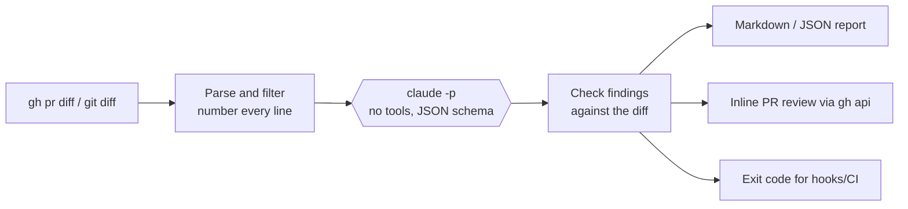

# AI GitHub Code Reviewer

A command-line code reviewer that reads a GitHub pull request or local git diff, has **Claude Code** review it headless (`claude -p`), checks every finding against the real diff, and posts the result to the PR as inline review comments.

It looks for **security problems, bugs, performance issues, code quality problems and missing tests**, and suggests concrete test cases for the change.

> Built for TCSS 490 (Generative AI and Software Development, UW Autumn 2026), Artifact 3: *AI Inside It*, a system where a model does real work every time it runs.

```text
$ ai-review --pr 1 --post
Fetching PR #1: Add user search, paging and avatars
  skip package-lock.json: generated or vendored file
Asking Claude to review 2 file(s), 1,193 chars...

## AI Code Review: ⛔ Changes requested
**7 finding(s)** across 2 file(s): 🔴 2 critical · 🟠 2 high · 🟡 2 medium · 🔵 1 low

1. 🔴 SQL injection in search_users via string concatenation.   app/users.py:19
2. 🔴 Path traversal in load_avatar.                             app/users.py:30
3. 🟠 API key hardcoded in source.                               app/users.py:3
...
Posted review on https://github.com/IbrahimCart/ai-code-reviewer/pull/1
```

The full output for the sample change is in [`examples/sample-review.md`](examples/sample-review.md).

## How it works



Only the hexagon is the model. Everything else is ordinary Python you can test without it.

## What the model does vs. what the code checks

The model's job is kept small and clear, so a bad review can be traced either to the model or to the code.

| Step | Owner | Details |
|---|---|---|
| Fetch the diff and PR title/description | Code (`diff.py`) | `gh pr diff`, `git diff base...HEAD`, staged changes or a diff file |
| Skip lockfiles, binaries, minified, vendored and deleted files | Code | The model never sees them |
| Fit the diff into a size budget | Code | Smallest files first; anything left out is listed in the report |
| Number every line with its new-file line number | Code | So the model can cite exact lines |
| **Read the change and decide what is wrong** | **Model** (`model.py`) | One `claude -p` call with **all tools disabled**. It can only read the diff it is given |
| **Rate severity, explain the risk, suggest a fix and tests** | **Model** | Output is forced into a JSON schema (`--json-schema`) |
| Reject findings for files that are not in the diff | Code (`validate.py`) | Catches made-up file names |
| Reject findings on lines the model was never shown; snap lines that are off by 1 or 2 | Code | GitHub rejects inline comments outside the diff, so this check is required |
| Reject unknown severities and categories, missing fields and duplicates | Code | The schema is enforced again rather than trusted |
| Recompute the verdict from the findings that survive | Code | The model can't say "approve" next to a critical bug |
| Decide the exit code (`--fail-on`) | Code | The model never decides whether a push is blocked |
| Post to GitHub | Code (`github.py`) | Always posted as a `COMMENT` review. It never approves or blocks a PR on its own |

Every dropped or adjusted finding is listed under **Review checks** in the report, so you can see when the model made a mistake and what the code did about it.

## Install

Requirements: Python 3.10+, [Claude Code](https://claude.com/claude-code) installed and signed in (`claude` on your PATH), and the [GitHub CLI](https://cli.github.com) (`gh auth login`) for PR features. There are no Python dependencies.

```bash
git clone https://github.com/IbrahimCart/ai-code-reviewer.git
cd ai-code-reviewer
pipx install -e .   # gives you the `ai-review` command; or run `python3 -m reviewer`
```

## Usage

```bash
ai-review --pr 12                       # review a PR in the current repo
ai-review --pr 12 --post                # ...and post inline review comments on it
ai-review --pr https://github.com/owner/repo/pull/12
ai-review --base main                   # review your branch's commits since main
ai-review --staged                      # review what you are about to commit
ai-review                               # review uncommitted changes
ai-review --diff-file examples/sample.diff --dry-run   # show the exact prompt; no model call
```

| Option | Meaning |
|---|---|
| `--fail-on high` | exit 1 if any finding is `high` or worse (also `critical`, `medium`, `low`; default `never`) |
| `--out review.md` / `--json review.json` | save the report |
| `--model sonnet` | choose the Claude model (default: Claude Code's default) |
| `--max-chars 60000` | diff size budget sent to the model |

Exit codes: `0` ok, `1` findings at or above `--fail-on`, `2` the review could not run.

### Block risky pushes with a git hook

```bash
cp hooks/pre-push /path/to/your/repo/.git/hooks/pre-push
```

Before each push, the hook reviews the commits you're pushing and blocks the push if anything is high or critical (`git push --no-verify` overrides it). If the reviewer itself fails, the push goes through, so a model outage never blocks you.

## Design decisions

- **`claude -p` instead of the Claude API.** The reviewer runs on an existing Claude Code subscription, so there is no API key to manage or leak and no per-call bill. The trade-off is that it runs where Claude Code is signed in (your machine), not as a hosted GitHub Action. The cost shown in the report is Claude Code's estimate, not a charge.
- **No tools for the model.** The model can't run commands or read files. It sees only the numbered diff, which keeps reviews fast (about 15 seconds), repeatable and safe to run on untrusted PRs. A prompt-injection attempt hidden in a diff can only affect the review's text, and the code still checks that.
- **Structured output plus a second check.** `--json-schema` makes the model answer in a fixed shape, and `validate.py` checks it again against the real diff. The tests cover each failure mode with a fake model.
- **A human stays in charge.** Reviews are posted as comments, never as approve or request-changes. The verdict and exit code come from code rules, not from the model.

## Tests

```bash
python3 -m unittest      # 30 tests; the model is mocked, so they are free and run in milliseconds
```

## Limitations

- Reviews only the diff, so it can miss bugs that depend on code outside the change.
- Large PRs are trimmed to the size budget. The skipped files are listed, not reviewed.
- AI feedback can be wrong. Treat it as a first pass before a human review, not a replacement for one.

## Project log

See [`LOG.md`](LOG.md) for the plan and what changed along the way.
